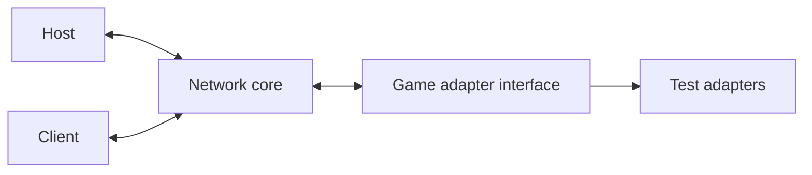

# Universal Seamless Co-op

**Experimental multiplayer networking architecture**

An independent prototype exploring reusable networking and synchronization mechanisms for cooperative multiplayer systems. The goal is to separate network behavior from game-specific integration, making core behavior testable without depending on a particular game.

## High-level architecture

## Documented network prototype

- Host-authoritative state management.
- Player-state replication and periodic snapshots.
- Connection retries and reconnect handling.
- Event deduplication and snapshot ordering.
- Tests for network robustness and authority handling using test adapters.

## Validation milestone

The private repository documents a network-core milestone dated August 15, 2026. Its README records successful runs of network robustness (10 cases), MVP (8 cases) and authority race (1 case) suites. These are historical, self-reported development results; this showcase does not claim a fresh test run or independent verification.

## Scope and limitations

The network core is a prototype. A complete playable co-op experience in a commercial game is not claimed. Real-game integration, end-to-end multiplayer validation, synchronized gameplay and persistent progression require further work.

## Engineering focus

Python, client-server systems, synchronization, state replication, fault handling and automated testing.

The underlying source and development history remain private. This showcase is not affiliated with any game publisher or studio.
